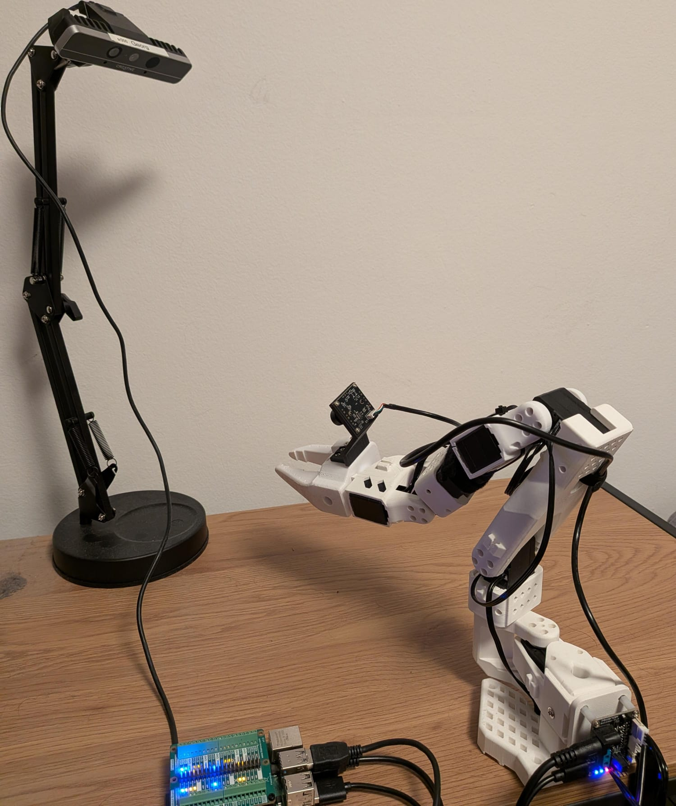
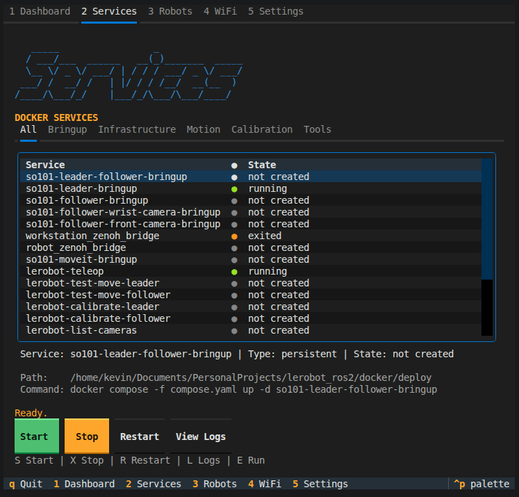

# LeRobot ROS2

**A modular ROS 2 framework for controlling, teleoperating, and developing LeRobot-compatible robotic arms.**

[](https://github.com/KevinEppacher/lerobot_ros2/actions/workflows/ci.yml)


## Overview

**LeRobot ROS2** provides a ROS 2-based software framework for operating and developing LeRobot-compatible robotic arms, with a primary focus on the **SO-101 robotic arm**.

The project integrates robot hardware with the ROS 2 ecosystem through a modular `ros2_control` architecture, enabling joint-level control, leader-follower teleoperation, motion planning, and camera-based perception.

To simplify development and deployment, the framework provides preconfigured Docker environments, container images distributed through GitHub Container Registry (GHCR), and a terminal-based management interface.

The system is designed to support both local development and distributed robotic setups, where a workstation communicates with robot hardware connected to a Raspberry Pi over a local network.

<p align="center">
  
</p>

## Features

- **ROS 2 Control Integration:** Modular hardware integration using `ros2_control` for managing robot joints and hardware interfaces.
- **Leader-Follower Teleoperation:** Real-time control of a follower robotic arm through a leader device.
- **Motion Planning:** Integration with MoveIt 2 for robot motion planning and execution.
- **Camera Integration:** Support for USB cameras and Intel RealSense devices for visual perception.
- **Docker-Based Deployment:** Reproducible ROS 2 environments with Docker Compose for running individual robot components and supporting services.
- **Prebuilt Container Images:** Motion and vision environments distributed through GitHub Container Registry (GHCR).
- **Terminal User Interface (TUI):** Interactive management of Docker services, system monitoring, and deployment configuration.
- **Distributed Communication:** Support for communication between a workstation and a Raspberry Pi over a local network.
- **Robot Calibration:** Configuration and calibration workflows for supported robot configurations.

## Supported Hardware

The framework currently focuses on the following hardware:

| Component | Supported Hardware |
|-----------|--------------------|
| Robotic Arm | SO-101 (5-DOF / 6-DOF configurations) with Hiwonder Bus Servos|
| Cameras | InnoMaker 720P USB 2.0 UVC Camera |
| Depth Cameras | Intel RealSense SR300 (used as RGB camera)|
| Embedded Computer | Raspberry Pi |
| Workstation | Linux-based development PC |

Hardware compatibility depends on the corresponding ROS 2 drivers, configuration files, and device interfaces.

## Installation

### Prerequisites

Before installing the framework, ensure that your system meets the following requirements:

- Ubuntu Linux
- Docker Engine
- Docker Compose plugin
- Git
- Python 3
- Access to the required USB devices when operating physical hardware

The installation script installs the host-side dependencies required to manage the deployment environment. 

> [!IMPORTANT]
> Docker Engine and the Docker Compose plugin must be installed separately.
> Follow the [Docker Installation Guide](docs/docker_install.md)
> before proceeding with the installation.

### 1. Clone the Repository

```bash
git clone https://github.com/KevinEppacher/lerobot_ros2.git
cd lerobot_ros2
```

### 2. Install Host Dependencies

Run the provided installation script:

```bash
./host/installation/install.sh
```

This prepares the host environment and installs the terminal-based management interface.

### 3. Download Container Images

Prebuilt ROS 2 Jazzy images are available through GitHub Container Registry.

**Motion environment:**

```bash
docker pull ghcr.io/kevineppacher/lerobot-ros2-motion:jazzy
```

**Vision environment:**

```bash
docker pull ghcr.io/kevineppacher/lerobot-ros2-vision:jazzy
```

These images provide preconfigured environments for running the corresponding ROS 2 components without manually building the complete workspaces.

### 4. Launch the Terminal Interface

```bash
lerobot-setup
```

The TUI provides an interactive entry point for managing the deployment environment.

## Quick Start

Before operating a physical robot, several hardware-specific configuration steps are required.

### Hardware Configuration

1. **Configure Servo Motors:** Assign the correct servo IDs and verify communication with the robot hardware.
2. **Identify USB Devices:** Determine stable device paths for the robotic arms and connected cameras.
3. **Calibrate the Robot:** Generate or configure the calibration files for the leader and follower arms.
4. **Select the Robot Configuration:** Configure the appropriate 5-DOF or 6-DOF robot model.
5. **Configure ROS 2 Communication:** Set up the required environment variables and network configuration.

Detailed setup instructions are available in the [Usage Documentation](docs/usage.md).

### Terminal User Interface (TUI)

The framework includes a terminal-based management interface built with Python and Textual.

Launch it using:

```bash
lerobot-setup
```

The interface provides:

- **Dashboard:** Monitor host CPU and memory usage, Docker connectivity, and container resource consumption.
- **Service Management:** Start, stop, and restart individual Docker Compose services.
- **Container Logs:** Inspect service output and troubleshoot deployment issues.
- **Configuration Management:** Access and edit deployment configuration files.

<p align="center">
  
</p>

The TUI is intended to simplify common development and deployment operations without requiring users to manually execute Docker Compose commands.

## Command-Line Interface (CLI)

All Docker services can also be managed directly through Docker Compose.

Navigate to the deployment directory:

```bash
cd docker/deploy/
```

### Start Robot Services

**Leader arm:**

```bash
docker compose up -d so101-leader-bringup
```

**Follower arm:**

```bash
docker compose up -d so101-follower-bringup
```

**Follower wrist camera:**

```bash
docker compose up -d so101-follower-wrist-camera-bringup
```

**Follower front camera:**

```bash
docker compose up -d so101-follower-front-camera-bringup
```

### Start leader-follower teleoperation

```bash
docker compose -f compose.motion.yaml up -d lerobot-teleop
```

## Development Environments

LeRobot ROS2 supports two workflows depending on whether the goal is to operate the robot or develop the underlying software.

### Prebuilt GHCR Images

The recommended approach for running the framework is to use the prebuilt container images distributed through GitHub Container Registry.

These images provide a reproducible runtime environment containing the required ROS 2 components and dependencies.

**Recommended for:**
- Operating supported robotic hardware
- Running leader-follower teleoperation
- Testing existing ROS 2 functionality
- Deploying the framework on different machines

### Development Containers

For developers modifying ROS 2 packages, hardware interfaces, or other framework components, the project provides a Docker-based development environment.

This workflow allows developers to build and test the software directly from source.

**Recommended for:**
- Developing ROS 2 packages
- Implementing custom hardware interfaces
- Extending robot control functionality
- Debugging and testing new features

For detailed instructions, see the [Docker Documentation](docs/docker_install.md).

## Architecture

LeRobot ROS2 follows a modular architecture that separates robot control, perception, deployment infrastructure, and host-side management.

The main components include:

| Component | Description |
|-----------|-------------|
| **Motion** | ROS 2 robot control, hardware interfaces, and motion planning |
| **Vision** | Camera drivers and perception-related components |
| **Docker Deployment** | Container orchestration and service configuration |
| **Host TUI** | Interactive deployment management and system monitoring |
| **Robot Hardware** | Physical leader and follower arms, cameras, and connected devices |
| **Network Communication** | ROS 2 communication between workstation and embedded robot hardware using configurable middleware implementations (RMW). |

The modular design allows individual components to be deployed and managed independently.

For a detailed description of the system architecture, see the [Architecture Documentation](docs/architecture.md).

## Configuration

Deployment settings are managed through Docker Compose files, environment variables, and hardware-specific YAML configuration files.

The deployment directory is organized as follows:

```bash
docker/deploy/
├── compose.yaml
├── compose.calibration.yaml
├── compose.infrastructure.yaml
├── compose.motion.yaml
├── compose.tools.yaml
├── config/
│   ├── calibration/
│   │   ├── 5dof/
│   │   │   ├── follower_example_calibration.yaml
│   │   │   └── leader_example_calibration.yaml
│   │   └── 6dof/
│   │       ├── follower_example_calibration.yaml
│   │       └── leader_example_calibration.yaml
│   ├── cyclonedds/
│   │   └── cyclonedds.xml
│   └── zenoh/
│       ├── robot.json5
│       └── workstation.json5
├── .env
└── .env.example
```

### Environment Variables

The `.env` file contains deployment-specific configuration values.

Create a local environment file from the provided template:

```bash
cp docker/deploy/.env.example docker/deploy/.env
```

Update the configuration to match your robot hardware, network setup, and ROS 2 environment.

The `.env` file is intended for local configuration and should not be committed to version control.

### Robot Calibration

Calibration files are organized by robot configuration:

- `config/calibration/5dof/`
- `config/calibration/6dof/`

Separate calibration files are provided for leader and follower robots.

These files define the hardware-specific calibration parameters required for correct joint operation.

### ROS 2 Communication

The deployment includes configuration files for different ROS 2 communication backends:

- **CycloneDDS:** DDS middleware configuration.
- **Zenoh:** Configuration for distributed communication between robot and workstation.

The selected communication configuration depends on the deployment environment.

## Roadmap

The following features are planned for future development:

- [ ] **Simulation Support:** Integration with Gazebo and NVIDIA Isaac Sim.
- [ ] **Robot State Interface:** Current robot mode displayed within the TUI.
- [ ] **Trajectory Validation:** Safety checks for teleoperation trajectories before execution.

Additional improvements and hardware support may be introduced as the project evolves.

## License

This project is licensed under the **Apache License 2.0**.

See the [LICENSE](LICENSE) file for details.
