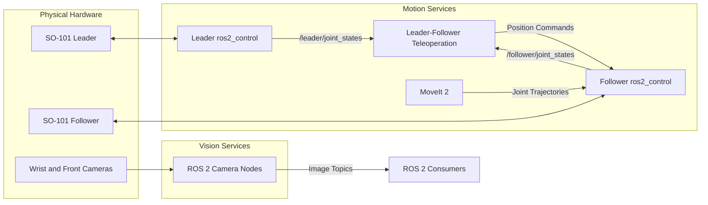
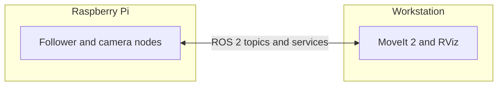
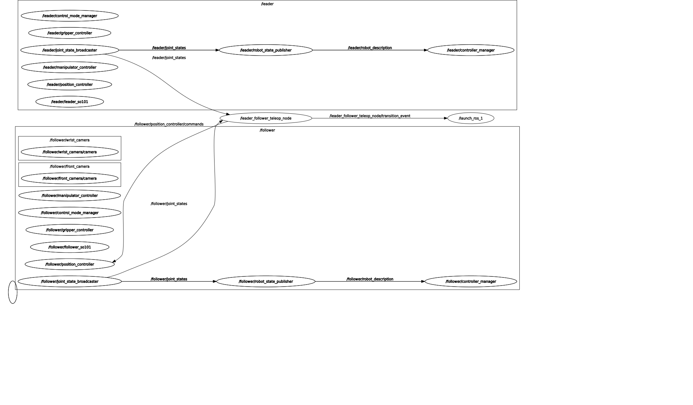
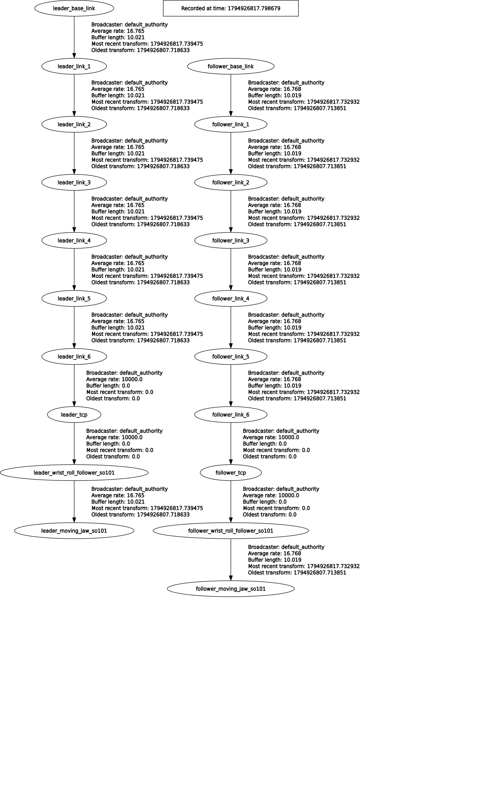
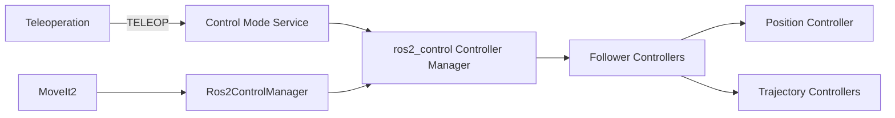
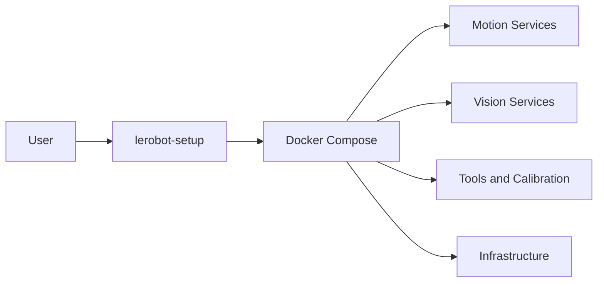

# Architecture

LeRobot ROS2 integrates SO-101 leader and follower arms, ROS 2 control, camera acquisition, and teleoperation in a Docker-based ROS 2 Jazzy deployment.

This document describes the system architecture, runtime communication, operating modes, controller management, and deployment infrastructure.

For setup instructions, see [Usage](usage.md).

## 1. System Overview



The architecture separates robot motion control from camera acquisition. Motion applications use ROS 2 joint-state, command, and service interfaces. Camera services publish image streams independently for ROS 2 consumers. The services can run on one host or across multiple hosts.

The diagram represents functional responsibilities rather than individual Docker containers or physical host assignments.

## 2. Container Architecture

The deployment uses separate container images for motion control and vision processing.

| Component | Responsibility | Main Components |
|---|---|---|
| **Motion** | Robot control and motion execution | SO-101 hardware interfaces, `ros2_control`, controller managers, joint-state publication, control-mode services, teleoperation, MoveIt2 |
| **Vision** | Camera acquisition | Wrist and front camera drivers, ROS 2 image publishers |
| **Host** | Deployment management | Docker Engine, Docker Compose, `lerobot-setup`, USB device mappings, environment configuration |

The combined arm bringup service runs both namespaced robot stacks in one container. The standalone arm services can run them in separate containers. Teleoperation, MoveIt 2, and each camera have their own Compose services. The `usb_cam` nodes publish under `/follower/wrist_camera` and `/follower/front_camera`. Hardware bringup runs on the host with the corresponding serial or video devices attached.

### Docker Compose Organization

| File | Scope |
|---|---|
| `compose.yaml` | Leader/follower and camera bringup |
| `compose.motion.yaml` | Teleoperation and motion utilities |
| `compose.calibration.yaml` | Leader/follower calibration |
| `compose.tools.yaml` | USB discovery, servo configuration, diagnostics, and camera discovery |
| `compose.infrastructure.yaml` | Optional robot and workstation Zenoh bridges |

## 3. Distributed Deployment and Communication

LeRobot ROS2 supports distributed deployment between a workstation and a Raspberry Pi.

Hardware bringup runs on the host where each device is attached. For example, the Raspberry Pi can run follower and camera bringup while the workstation runs MoveIt 2 and RViz. The workstation can also run leader bringup if the leader is connected there.



The ROS 2 bringup and motion services use host networking and default to `rmw_cyclonedds_cpp`. Direct DDS communication requires compatible ROS 2 settings and network connectivity that supports DDS discovery and traffic.

`compose.infrastructure.yaml` also provides optional `zenoh-bridge-ros2dds` services under the `robot` and `workstation` profiles. They bridge ROS 2 DDS traffic over Zenoh. The robot bridge listens on TCP port `7447`, and the workstation config requires replacing the endpoint placeholder with the robot host address. The bridge services load the supplied loopback-only Cyclone DDS configuration. The regular ROS 2 services do not load that configuration through Compose.

The deployment MoveIt service requests RViz with `gui:=true`. The deployment file leaves display forwarding to the host configuration.

## 4. ROS 2 Runtime Graph

The following graph shows the ROS 2 nodes and communication interfaces captured from a running deployment.



The graph includes:

- Leader and follower hardware interfaces.
- `ros2_control` controller managers.
- Joint-state broadcasters and robot-state publishers.
- Leader-follower teleoperation.
- Wrist and front camera nodes.

The graph represents a runtime snapshot. Controller switching and service interactions are not necessarily visible in the displayed topic connections.

## 5. Robot Kinematics and TF

Standard arm bringup publishes independent TF trees rooted at `leader_base_link` and `follower_base_link` when using the default namespaces. Bringup prefixes link names with the robot namespace. The separate workcell launch includes follower bringup with a workcell description that attaches the robot to a table under a `world` frame.



Each TF tree represents the corresponding robot's kinematic chain.

Joint transforms are published using the robot description and current joint states.

The displayed timestamps and publication rates are specific to the captured runtime state.

## 6. Operating Modes

LeRobot ROS2 supports different operating modes for manual guiding, teleoperation, and trajectory execution.

### Control Modes

Each arm exposes `/<namespace>/set_control_mode` using `lerobot_interfaces/srv/SetControlMode`. The service selects which motion controllers are active.

| Mode | Value | Description |
|---|---|---|
| `IDLE` | `0` | Deactivates all three managed motion controllers |
| `TELEOP` | `1` | Activates `position_controller` |
| `TRAJECTORY` | `2` | Activates both trajectory controllers |

The corresponding ROS 2 service interface is:

```text
uint8 IDLE=0
uint8 TELEOP=1
uint8 TRAJECTORY=2

uint8 mode
---
bool success
string message
```

### Operating Scenarios

| Operating Scenario | Description | Controller |
|---|---|---|
| **Manual Guiding** | Leader joints can be positioned manually | Guiding-mode interface |
| **Leader-Follower Teleoperation** | Follower tracks the leader's joint positions | `position_controller` |
| **MoveIt2** | Executes planned manipulator and gripper trajectories | `manipulator_controller`, `gripper_controller` |
| **Hardware Diagnostics** | Servo configuration, calibration, and manual testing | Dedicated hardware utilities |

The control-mode manager queries the current controller states, requests a strict switch when needed, and verifies the resulting states. The joint-state broadcaster stays active across mode changes. Guiding mode separately disables motor torque in the hardware interface and suppresses position writes while active.

## 7. ros2_control and Controller Management

Bringup runs a namespaced `controller_manager` and `robot_state_publisher` for each arm. The `lerobot_ros2_control/LeRobotSystemHardware` plugin uses calibration data to convert between joint positions and servo positions, and the `hiwonder_lerobot_cpp/Robot` backend communicates with the HiWonder servo bus. Bringup selects the matching robot description and controller configuration for 5 or 6 arm joints plus the gripper.

### Available Controllers

| Controller | Type | Purpose |
|---|---|---|
| `joint_state_broadcaster` | `JointStateBroadcaster` | Publishes current joint states |
| `position_controller` | `ForwardCommandController` | Direct position control during teleoperation |
| `manipulator_controller` | `JointTrajectoryController` | Manipulator trajectory execution |
| `gripper_controller` | `JointTrajectoryController` | Gripper trajectory execution |

Bringup activates the joint-state broadcaster and position controller and spawns both trajectory controllers inactive. This is also the expected follower controller state during teleoperation.

```bash
$ ros2 control list_controllers -c /follower/controller_manager

position_controller     forward_command_controller/ForwardCommandController    active
gripper_controller      joint_trajectory_controller/JointTrajectoryController  inactive
manipulator_controller  joint_trajectory_controller/JointTrajectoryController  inactive
joint_state_broadcaster joint_state_broadcaster/JointStateBroadcaster          active
```

### Automatic Controller Switching

Controller activation depends on the selected motion interface.



The diagram shows the follower side. The control-mode service and MoveIt 2 both switch controllers through the follower controller manager. A controller switch leaves the teleoperation node in its current lifecycle state.

### 7.1 Leader-Follower Teleoperation

The standalone teleop launch configures and activates the lifecycle node. On activation, the node requests `TELEOP` through both `/leader/set_control_mode` and `/follower/set_control_mode`. It waits for joint states from `/leader/joint_states` and `/follower/joint_states`, then aligns the follower to the leader by publishing to `/follower/position_controller/commands`.

After alignment, the node requests guiding mode through `/leader/leader_so101/guiding_mode` and starts tracking the leader. Tracking can apply a low-pass filter, which is enabled in the default configuration. On lifecycle deactivation, the node stops tracking and requests that leader guiding mode be disabled. The motion controllers retain their current states until another switch.

### 7.2 MoveIt 2 Trajectory Execution

The MoveIt launch sets `moveit_manage_controllers=true` and points the `moveit_ros_control_interface/Ros2ControlManager` plugin at the selected ROS control namespace (default `/follower`). MoveIt uses that plugin to discover and switch controllers when executing a planned trajectory. The `TRAJECTORY` request on the control-mode service is independently available and activates both trajectory controllers.

The trajectory controllers expose these `FollowJointTrajectory` actions under the default namespace.

- Arm joints: `/follower/manipulator_controller/follow_joint_trajectory`
- Gripper: `/follower/gripper_controller/follow_joint_trajectory`

### 7.3 Controller Selection Summary

| Component | Teleoperation | MoveIt2 |
|---|---|---|
| `position_controller` | Active | Deactivated when MoveIt activates a conflicting trajectory controller |
| `manipulator_controller` | Inactive | **Active when required** |
| `gripper_controller` | Inactive | **Active when required** |
| `joint_state_broadcaster` | Active | Active |
| Controller management | Control-mode service | MoveIt `Ros2ControlManager` |
| Command interface | Position command topic | `FollowJointTrajectory` actions |

## 8. Deployment Management: lerobot-setup

`lerobot-setup` is a host-side terminal user interface for managing the Docker deployment.

It invokes the Docker Compose CLI and displays local host and container information. Robot nodes handle motion and ROS 2 communication.



The TUI provides:

- Docker container and service management.
- Service startup and shutdown.
- Container status and log inspection.
- Host and container resource monitoring.
- Access to deployment configuration.

## 9. Further Documentation and Configuration

- [Usage](usage.md) covers hardware discovery, calibration, camera setup, and deployment.
- [Teleoperation defaults](../packages/lemotion/lerobot_teleop/config/leader_follower_config.yaml) define the topics, services, alignment duration, and filter settings.
- [MoveIt launch](../packages/lemotion/lerobot_moveit_config/launch/moveit.launch.py) configures namespacing and execution.
- [HiWonder backend](../packages/lemotion/hiwonder_lerobot_cpp/README.md) documents calibration and hardware tools.
