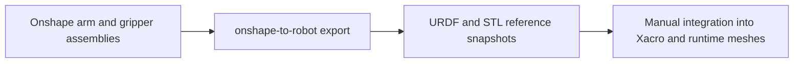

# so101_description

## Overview

`so101_description` provides modular Xacro models for the 5-DOF and 6-DOF
SO-101 arms, with RViz visualization and descriptions for hardware bringup.
Both stock models attach the follower gripper. The leader gripper Xacro is an
intentional placeholder.

## Structure

The [robot entry points](urdf/robots/) compose a reusable arm macro, the
[follower gripper](urdf/links/gripper/follower/gripper_link.xacro), shared
materials, and a matching [ROS 2 control macro](urdf/control/). The arm macros
combine common and variant-specific [links](urdf/links/) with each variant's
[joint chain](urdf/joints/). Each arm exposes a fixed `tcp` frame for attaching
the gripper or another tool when composing a robot.

## Usage

In a sourced ROS 2 Jazzy workspace, launch RViz and the joint-state sliders
without connecting hardware.

```bash
ros2 launch so101_description display.launch.py dof:=6 robot_type:=follower
```

Set `dof` to `5` or `6`. Set `robot_type` to `leader` or `follower` to choose
the namespace, frame prefix, and RViz preset. Both roles use the same geometry
for a given DOF. Set `gui:=false` to use the plain joint-state publisher and
skip RViz. See [`display.launch.py`](launch/display.launch.py).

## CAD Workflow



See the [CAD workflow guide](urdf/onshape_to_robot/README.md) for export,
comparison, and integration steps.

## Configuration

For hardware, select a calibration matching the arm's DOF and role, then supply
the serial device and the calibration for your arm through
[`lerobot_bringup`](../../lebringup/lerobot_bringup/README.md). See the
[calibration guide and examples](config/README.md) and the
[calibration CLI](../../lemotion/hiwonder_lerobot_cpp/README.md#lerobot-calibrate).

## Credits

The original SO-101 arm was developed by The Robot Studio in collaboration
with Hugging Face. [Original SO-101 project](https://github.com/TheRobotStudio/SO-ARM100)

The 6-DOF model in this package draws on EmbodiedAI-Group's hardware extension,
including its `link_4` design. [SO-ARM101-6DoF](https://github.com/EmbodiedAI-Group/SO-ARM101-6DoF)
