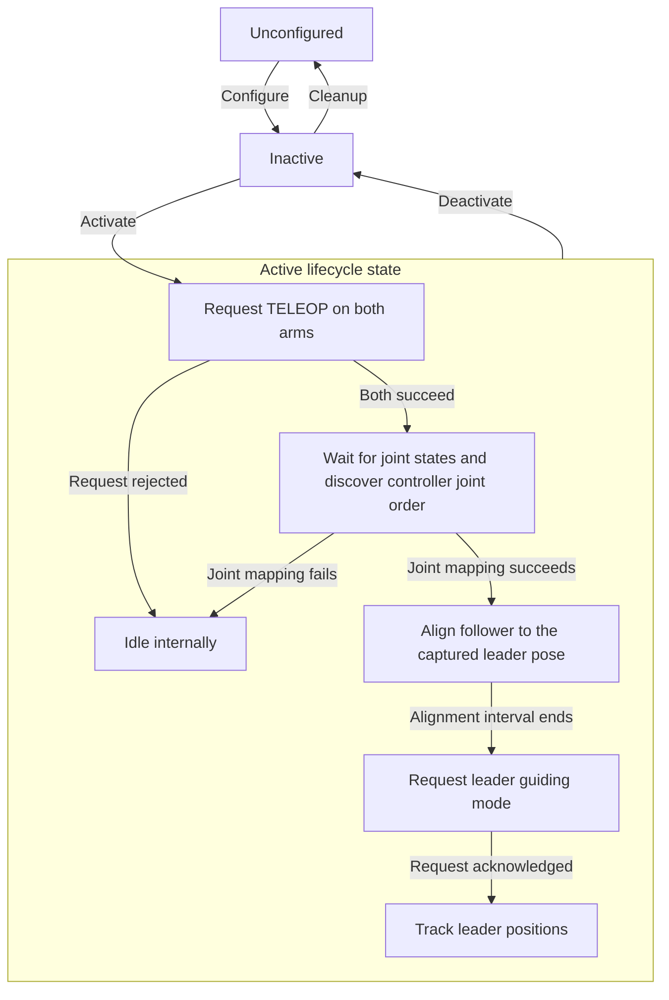

# lerobot_teleop

## Overview

`lerobot_teleop` mirrors a leader arm's joint positions through the follower's
ROS 2 position controller. The stock SO-101 bringup supports matching 5-DOF
and matching 6-DOF pairs, including the gripper.

## Architecture

The `leader_follower_teleop_node` lifecycle node reads
`sensor_msgs/msg/JointState` from both arms and sends position commands as
`std_msgs/msg/Float64MultiArray` to the follower. The follower first aligns
to a snapshot of the leader pose, then tracks the leader with optional
low-pass filtering. Calibration and servo I/O are handled by
[`lerobot_ros2_control`](../lerobot_ros2_control/README.md).

The bundled launch configures and activates the node automatically. Once
active, the node requests `TELEOP` from both arms through
[`lerobot_control`](../lerobot_control/README.md), which switches the managed
controllers to position control.



## Usage

In a sourced workspace, set `leader_port`, `follower_port`,
`leader_calibration`, and `follower_calibration` in your shell to the two
serial paths and calibration files. See
[SO-101 bringup](../../lebringup/lerobot_bringup/README.md) for hardware setup.
**Clear the follower's workspace before launching. Alignment can move the
follower as soon as the prerequisites are ready.**

```bash
ros2 launch lerobot_bringup so101_teleop.launch.xml \
  dof:=5 leader_port:="$leader_port" follower_port:="$follower_port" \
  leader_calibration_path:="$leader_calibration" \
  follower_calibration_path:="$follower_calibration"
```

Use `dof:=6` for a matching 6-DOF pair. If both arms are already running
with the configured endpoints, start teleoperation separately with
`ros2 launch lerobot_teleop leader_follower_teleop.launch.py`. That launch
loads the bundled YAML and activates the node.

To stop publishing and request that the leader exit guiding mode, deactivate
the node before ending the launch.

```bash
ros2 lifecycle set /leader_follower_teleop_node deactivate
```

Deactivation leaves the arms' controller modes and follower torque unchanged.
A guiding service acknowledgment confirms receipt of the request. The hardware
adapter applies the torque change in its write cycle.

## Configuration

The [bundled YAML](config/leader_follower_config.yaml) defines the
`/leader` and `/follower` endpoints, update rate, alignment duration, leader
timeout, and tracking filter. The follower command topic must have a controller
subscriber with a readable `joints` parameter. The stock controller is
`position_controller`. Teleop matches exact names in both arms' feedback and
orders commands by that parameter. Feedback order can differ, and extra joints
are ignored. Joint names, including any prefixes, must match for each
commanded joint.

## Safety

Teleop performs no collision checks or local joint-limit enforcement.
Alignment ends after the configured interval, without checking that the
follower reached the target. The hardware adapter clamps position commands
to its configured joint limits.

During tracking, missing commanded joints or a timeout in received leader
states pauses new commands. Valid feedback can resume tracking without
realignment. There is no freshness check during alignment or for follower
feedback. The follower controller can keep applying its last target when
publishing stops. A timeout or process exit does not guarantee a stop or
release of torque.

## Testing

From the built workspace, run the integration tests with mock ROS endpoints.
They cover alignment, tracking, leader timeout, and joint mapping.

```bash
colcon test --packages-select lerobot_teleop --return-code-on-test-failure
```
